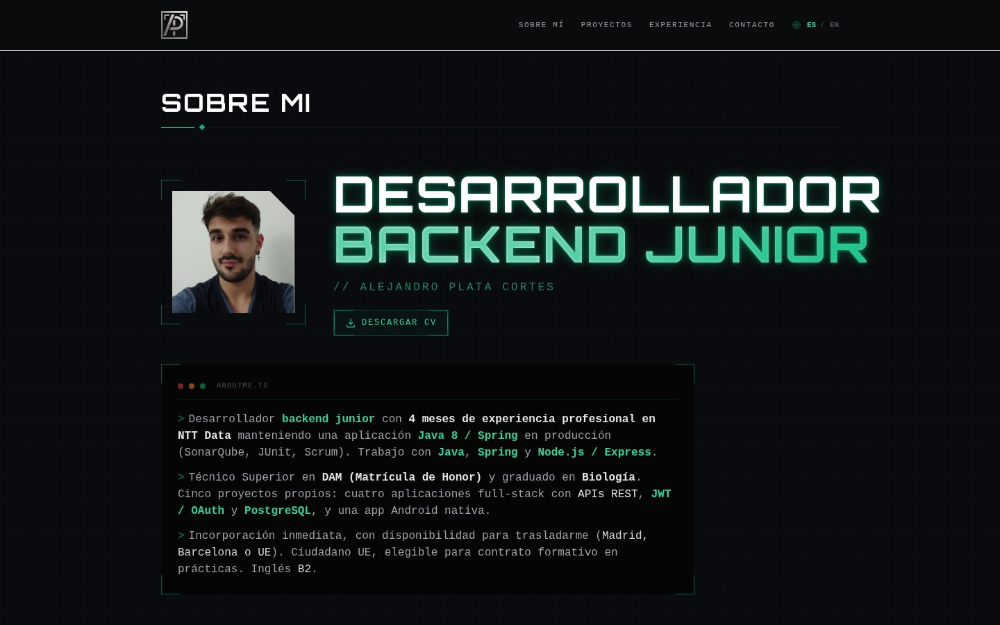
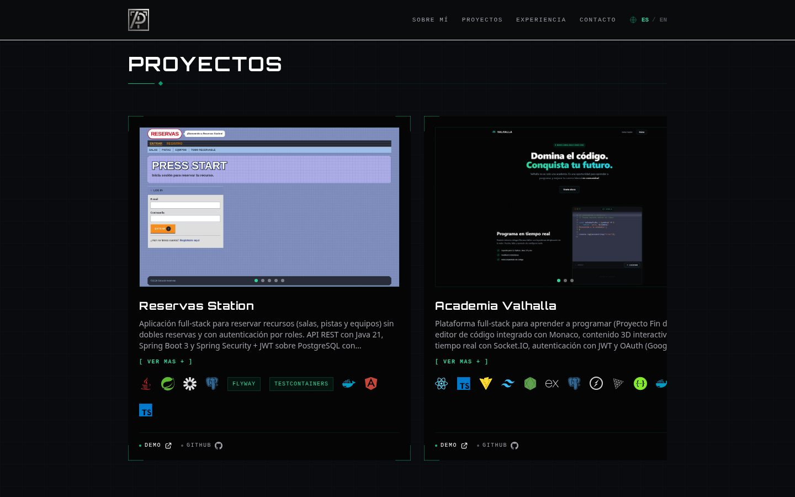
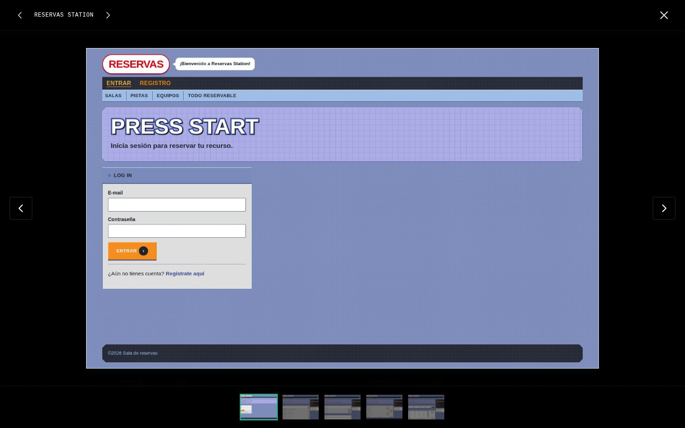
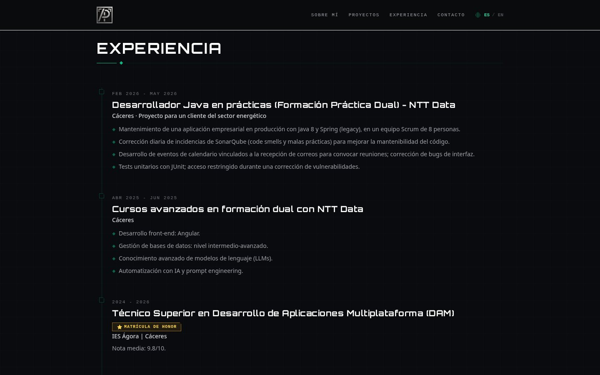
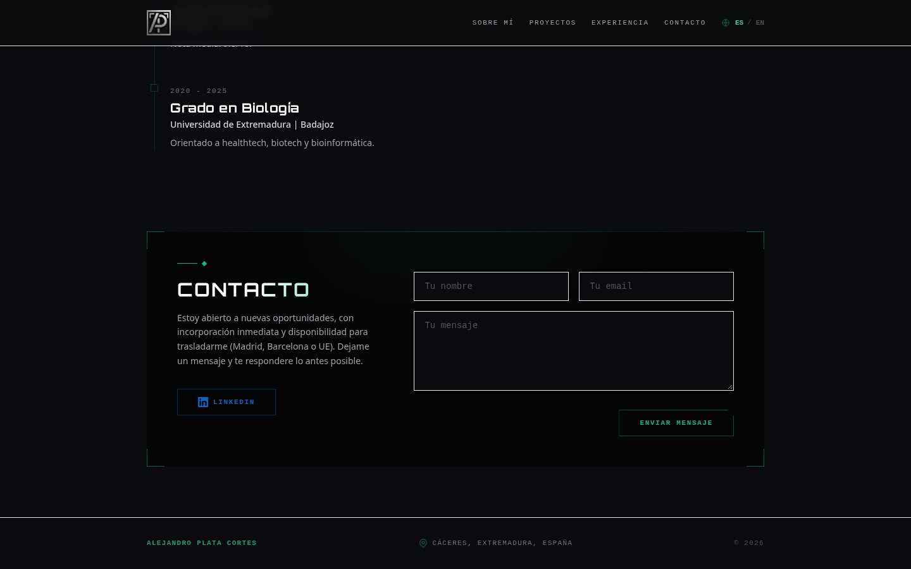
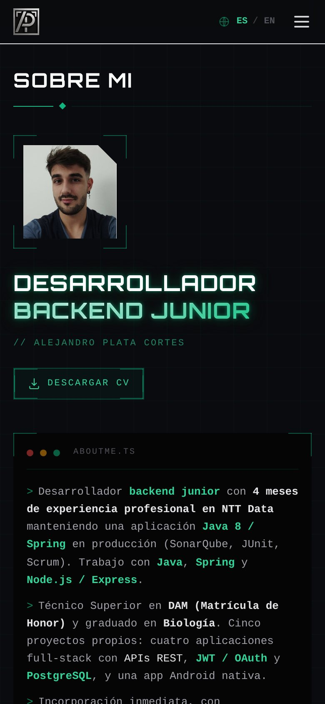

<h1 align="center">Portfolio · Alejandro Plata Cortés</h1>

<p align="center">
  <b>Desarrollador backend junior · Java · Spring · Node.js</b><br>
  Mi portfolio personal: quién soy, mis proyectos, mi experiencia y cómo contactarme. Bilingüe (español / inglés).
</p>

<p align="center">
  <a href="https://github.com/Alejandro-Plata"><b>GitHub</b></a> ·
  <a href="#capturas">Capturas</a> ·
  <a href="#arranque-local">Arranque local</a>
</p>

<p align="center">
  
  
  
  
  
</p>

<p align="center">
  
</p>

## Qué incluye

| | |
|---|---|
| **Sobre mí** | Presentación alineada con mi CV y descarga del CV en PDF |
| **Proyectos** | Carrusel automático con los cinco proyectos, vista ampliada con galería de capturas y vídeo, iconos de tecnologías y enlaces a la demo y al código |
| **Experiencia** | Línea de tiempo con prácticas en NTT Data y formación |
| **Contacto** | Formulario con envío por correo (Web3Forms, con campo anti-spam) y enlace a LinkedIn |
| **Bilingüe** | Español e inglés con cambio instantáneo; recuerda el idioma elegido y usa el del navegador la primera vez |
| **Responsive** | Diseño adaptado a móvil, con menú y carrusel táctil |
| **SEO** | Metaetiquetas, Open Graph, tarjeta de Twitter y datos estructurados (JSON-LD) |

## Capturas

<table>
<tr><td align="center"><br><sub><b>Carrusel de proyectos</b></sub></td><td align="center"><br><sub><b>Galería de un proyecto</b></sub></td></tr>
<tr><td align="center"><br><sub><b>Experiencia</b></sub></td><td align="center"><br><sub><b>Contacto</b></sub></td></tr>
</table>

<p align="center">
  
</p>

## Stack

| Capa | Tecnologías |
|---|---|
| Framework | Angular 19 (componentes *standalone* y señales), TypeScript |
| Estilos | Tailwind CSS 3, fuente Orbitron, iconos Devicon |
| Contenido | Textos en `i18n/i18n.service.ts` (ES / EN) y proyectos en `models/project.model.ts` |
| Contacto | Web3Forms |
| Despliegue | Vercel |

## Arranque local
Necesitas Node.js 20+.

```bash
npm install
npm start          # http://localhost:4200
npm run build      # salida en dist/portfolio
```

## Estructura
```
portfolio/
├── src/
│   ├── app/
│   │   ├── components/    # navbar, about, projects, experience, contact, footer
│   │   ├── i18n/          # Diccionarios ES / EN y servicio de idioma
│   │   └── models/        # Lista de proyectos
│   ├── assets/            # Foto, logo, CV en PDF y capturas / vídeo de los proyectos
│   └── index.html         # SEO, Open Graph y JSON-LD
└── docs/screenshots/      # Capturas de este README
```

## Cómo añadir un proyecto
1. Copia sus capturas en `src/assets/projects/<nombre>/`.
2. Añade una entrada a `PROJECTS` en `src/app/models/project.model.ts` con título, descripción (ES / EN), tecnologías, imágenes y enlaces.
3. Si usa una tecnología sin icono, añádela a `iconMap` en `projects.component.ts`.

---
<p align="center">Hecho por <a href="https://github.com/Alejandro-Plata">Alejandro Plata Cortés</a></p>
